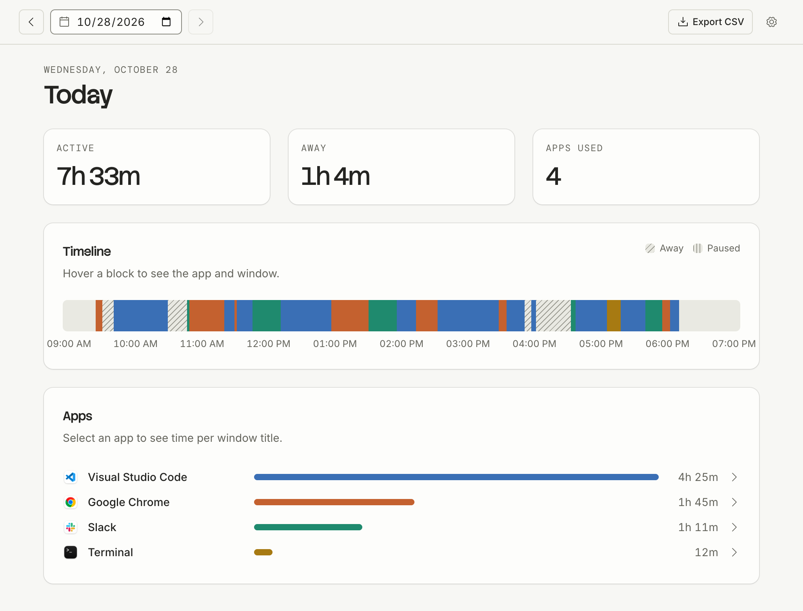
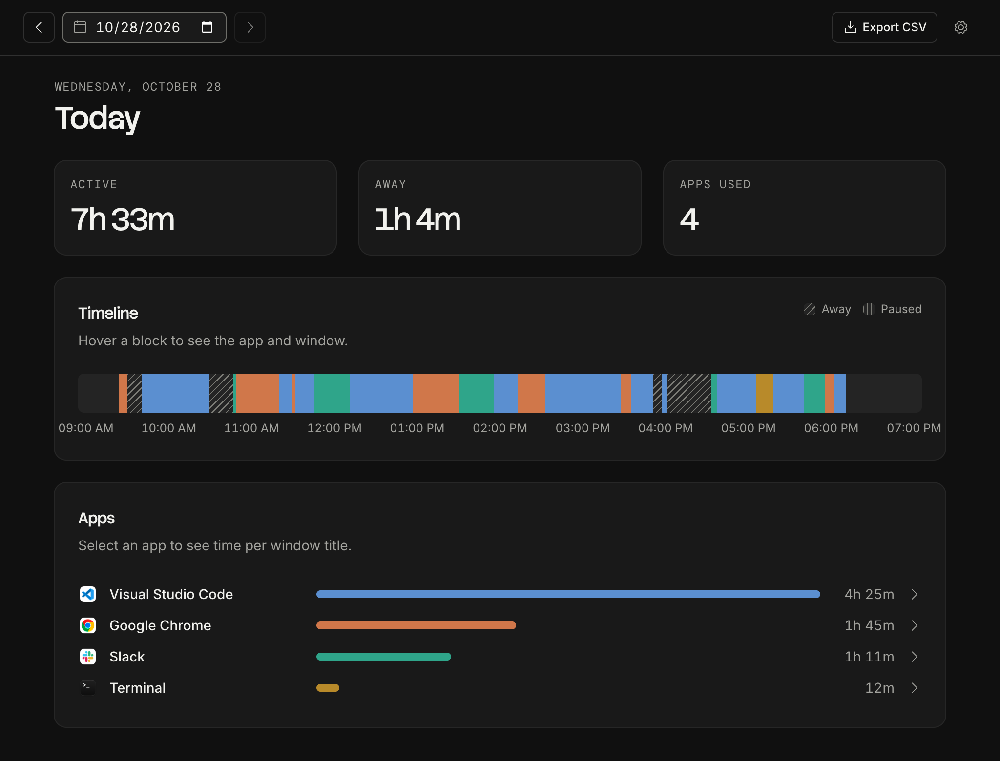

# Lock In

<p>
  
  
</p>

A personal macOS menu-bar activity tracker built with Tauri 2, React and TypeScript: an
ActivityWatch alternative. See [SPEC.md](SPEC.md) for what v1 does.

## Build and install

macOS ties privacy permissions to the app's signature. Signing every build with the same
self-signed certificate keeps Screen Recording permission from resetting after each rebuild.

1. Create the certificate once (macOS may ask for your keychain password):

   ```bash
   ./scripts/create-signing-cert.sh
   ```

2. Build the signed app:

   ```bash
   pnpm build:app
   ```

3. Move `src-tauri/target/release/bundle/macos/Lock In.app` to `/Applications` and open it.
   On first run it turns on launch at login and asks for Screen Recording permission, which it
   needs to read window titles. If you dismissed the prompt, enable **Lock In** in
   **System Settings → Privacy & Security → Screen & System Audio Recording**.

## Develop

```bash
pnpm install
pnpm tauri dev
```

Dev builds open the dashboard on launch. `pnpm dev` alone serves the dashboard in a normal browser
with sample data, which is handy for UI work.

Rust tests (the probe smoke test is ignored by default because it reads the live machine):

```bash
cd src-tauri && cargo test
```

## Where things live

- Data: `~/Library/Application Support/com.arj.lockin/lock-in.sqlite3`
- Tracker logic: `src-tauri/src/tracker.rs`; macOS probes: `src-tauri/src/probe.rs`
- Dashboard: `src/`
